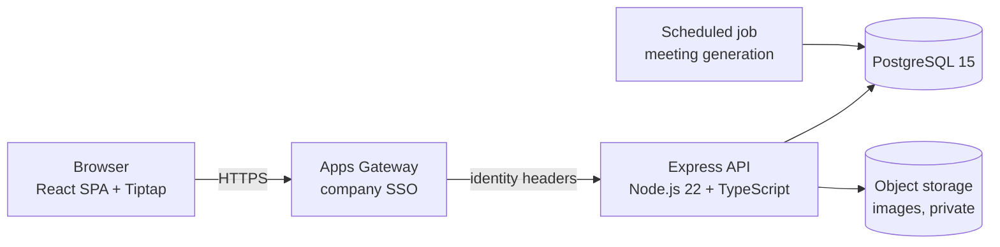

# PRD & RFC: Weekly Meeting Notes

Nov 20, 2026 · Owner: _(GitHub login, owner input)_ · Status: **Draft for mentor review**

## 1. Background and goals

Today each person keeps their progress notes in their own Word files. Before a team meeting someone has to collect those files, open them one by one, and the history of a project is scattered across many documents. This website replaces the Word files with notes written in the browser: the parts about a project show on that project's page, and notes are gathered per meeting.

Conditions the system must handle:

- People write in their own style: headings, bold and italic, bullet lists, tables, pasted screenshots. The editor must feel like Word, not like a form.
- A project lasts for many weeks. A person's weekly update often covers several projects, sometimes one sentence each, so one note holds the updates for several projects (owner, 2026-11-23).
- Teams meet on fixed days that differ per team (for example every Wednesday and Friday). A meeting shows the notes people chose to bring to it.
- Everyone signs in through the company Apps Gateway, but signing in is not enough: a website admin must activate a person before they can use anything.

Goals:

1. A Word-like editor whose notes are saved without loss and reopen exactly as written.
2. One page per meeting that shows every note linked to it, grouped by person, so nobody collects files.
3. Meeting schedules per team that the team leader sets once, with the dates generated automatically.
4. Access controlled from day one: inactive by default, least privilege, enforced by the backend on every request.

## 2. Scope

In scope:

- Sign-in through Apps Gateway; first sign-in creates the user as inactive.
- Website roles `user` and `admin`; a person can hold both and picks one in the UI ("Change Role").
- Users page for website admins: activate or deactivate people, grant or remove admin.
- Teams with members; team roles `leader` and `member`.
- Projects owned by one user. Notes owned by one user, written in a rich-text editor (bold, italic, underline, headings, lists, tables, images, links); parts of a note are tagged with the owner's projects (project sections).
- Meeting series per team with days of the week; dated meetings generated from them; meeting status `scheduled`, `cancelled`, `done`.
- Sharing notes on meetings: the owner picks the meetings (one click for the next one); teammates read them on the meeting's board.
- Meeting page: every note linked to that meeting, read-only.
- Full-text search over the user's own notes.

Out of scope (first release):

- Real-time co-editing, shared projects, or comments on notes.
- Version history of a note.
- Export to Word or PDF.
- Notifications (email, chat) and calendar integration.
- Meeting times; a meeting has a date only, in Indonesia time (UTC+7).
- A mobile app; the website only needs to be usable on a phone for reading.

## 3. Functional requirements

FR-1 to FR-10 are required for the first release.

| ID | Requirement | Priority |
| --- | --- | --- |
| FR-1 | Take the user's identity from Apps Gateway. A first sign-in creates the user with status `inactive` and website role `user`; later sign-ins update the name only. | Must |
| FR-2 | An inactive user sees only a "waiting for activation" page. Every API route except sign-in, sign-out and `GET /api/me` answers 403 `account_inactive`, checked against the database on every request. | Must |
| FR-3 | Website admins list users (search by name or email, filter by status and role), activate or deactivate them, and grant or remove the `admin` role. An admin cannot change their own status or roles. Someone is **waiting for access** when inactive and signed in after their last deactivation, or never deactivated (owner, 2026-11-24): a new person, or one deactivated who came back; someone deactivated who has not signed in again is not. The admin's Home lists who is waiting (the five newest by sign-in, then a count) with "Review and activate", which opens the Users page showing only them; the Users link in the menu shows how many wait, on every admin page; the Users page marks them "Waiting", filters by "Waiting for access", and, when another filter is on, says how many wait with "Show only them". All of it checks again every minute. | Must |
| FR-4 | A user who holds both website roles picks the active one in the UI; the choice is kept in the session, not the database. | Must |
| FR-5 | Any active user creates a team (name, optional description; names may repeat) and becomes its leader. A team has exactly one leader. The leader adds active users directly (no invitation; the "Add people" box suggests 5 random active people not yet in the team before anything is typed, with "Show others", and searches everyone by name or email from 2 letters on; owner, 2026-11-23), removes members, edits the team, and hands leadership to another member: that member becomes leader and the old leader a member, after a confirmation. Members can leave; the leader cannot leave or be removed without handing over first (Section 8.5). | Must |
| FR-5a | The leader deletes a team by typing its name. The team is archived for 30 days: hidden from members, read-only, and the leader at the time of deletion can restore it. After 30 days it is deleted for good with its meeting series and meetings; notes stay. Under "Deleted teams" the leader picks teams with a box on each row (or Select all), as in OneDrive's recycle bin, and a bar over the list restores them or deletes them for good at once, after one confirmation that names how many (owner, 2026-11-25). | Must |
| FR-6 | A user creates, renames and archives their own projects. Only the owner can see a project. Names are unique per person, ignoring case. An archived project is read-only until restored; archiving offers Undo. Its parts in notes are frozen (owner, 2026-11-25: archived means done): they keep the project's name, marked "archived · read-only", and cannot be changed, moved to another project or removed until it is restored; they stay on its page. A copy of a note leaves them out. A project can also be made from the editor's Project menu: type a new name and pick "+ Create project “…”", which tags the part at once (owner, 2026-11-25). The owner can delete a project for good by typing its name; notes stay, and the parts tagged with it become untagged text (owner, 2026-11-23). A **Projects** menu page lists them as cards, 12 to a page with numbered pages above and below (owner, 2026-11-25), everything filtered, sorted and counted on the server: Active / Archived (the counts follow the filters), words in the name or description, **Last update** (in the past 7, 30 or 90 days, over 90 days ago, or no updates yet), **Shared** (on any meeting, on none, or on a chosen team's meetings: the Notes page's searchable team picker) and the order (recently updated, least recently updated, most updates, name, newest, oldest); all in the address, and a new filter starts from page 1; each project has its own page with in-place editing of name and description (owner decisions 2026-11-20). A new project stays on the list (owner, 2026-11-25): Active, page 1, no filters, where it shows first and lit for a moment, with "… was created · Open it". | Must |
| FR-7 | A user writes their own notes with a rich-text editor (bold, italic, underline, strikethrough, headings 1–3, bullet and numbered lists, quotes, code blocks, tables, images, links, text alignment, text color from the BLUE palette, divider lines). A note is not inside a project: any part of it can be put in a **project section** tagged with one of the user's active projects (the editor's Project button: inside a section it changes the project, otherwise it wraps the current lines; the section's chip changes the project or removes the section, keeping its text; the × on the section deletes it when nothing is written in it, else removes the tag and keeps the text; Backspace at the start of an empty section deletes it). Text outside sections stays in the note only. One note can hold sections for several projects, one sentence each if the user likes; pressing Enter on an empty last line leaves a section. A **Notes** menu page lists the user's notes 10 to a page (owner, 2026-11-25) with numbered pages (above and below the list, as every paged list: owner, 2026-11-24), grouped by month, with the projects each has sections for; everything is filtered, sorted and counted on the server so years of notes stay quick (owner, 2026-11-24): words in the title or text, project (or no project; a searchable picker like "Add people" on a team: before typing it offers a few of the user's projects at random with "Show others", and from 2 letters it searches all of them by name, so a long list is never scrolled), shared or not or on a given team's meetings (the same searchable picker, over the user's teams), written from / until, and newest first, oldest first or last edited first. Filters and page are in the address, and a note opened from the list returns to the same page. Each row has a box to pick it (a click anywhere on the strip left of the date ticks it), and a box over the list picks the whole page (owner, 2026-11-25, like OneDrive); once one or more notes are picked, a bar over the list (it stays in view while scrolling) acts on them together: **Open** for one note; **Share on a meeting…** (the editor's meeting choices in a dialog, a box a meeting; with several notes a box is ticked when all of them are on the meeting and shows "–" with "2 of 3 notes" when only some are; ticking puts the rest on, unticking takes them all off; each change is saved at once and said under the list), **Make a copy** / **Make copies** (each a new note with the same text, project sections for active projects (an archived project's parts are left out, owner 2026-11-25) and its own copies of the images, shared on no meeting, titled "Copy of …"; one copy opens at once, several stay on the list with a count), **Download ▾ as Word** / **as PDF** (each note alone, one file a note, built in the browser like the quarter's files: its title, who wrote it and when, where it is shared, then its project sections as headings; in English, as every download) and **Delete…** (after one confirmation naming how many) for one or several; and **× N selected** to let go. Only notes on the page shown can be picked; Escape, or moving to another page or filter, lets go. Inside a note, each project section's chip menu has **Copy section**, **Cut section** and **Paste section below**, and the toolbar's Project menu has **Paste copied section here** (at the cursor), so a project's part moves between notes (owner, 2026-11-24); pasted into another note, its pictures are copied into that note first. The copied section is kept in the tab's memory only (and put on the system clipboard for Ctrl+V), never in the browser's storage. Each note has its own page laid out like a document; "New note" opens it at once. The note is saved automatically and reopens exactly as written. Images are pasted, dropped or picked (several at once go one below the other), and can be resized. Pictures up to 25 MB and GIFs up to 100 MB (a phone's screen recording) are accepted and made smaller in the browser before upload, keeping screenshots pixel-exact and animations moving (owner, 2026-11-23; flow 8.3). An archived project keeps the sections it has but is not offered for new ones. The owner deletes a note after a confirmation, its images included (owner decisions 2026-11-20 and 2026-11-23). A long note has "Back to top" once scrolled down (owner, 2026-11-25). | Must |
| FR-8 | Only the team leader sets up meeting schedules (series) for their team: a name and the days of the week; meetings start from today. A team can have several (at most 10). The leader renames a schedule, changes its days, stops and restarts it, or deletes it while none of its meetings holds notes. Dated meetings exist four weeks ahead; a meeting whose day has passed is `done`. A meeting is called by its schedule's name, such as "Weekly Update" (owner, 2026-11-24: no separate meeting titles). For one meeting the leader cancels it (with an optional reason, shown with the cancellation), reopens it (the reason goes), or moves it to another day; cancel, reopen and move only until its day has passed (owner decisions 2026-11-20, Section 8.4). | Must |
| FR-8a | Members see their team's schedules and its quarters on the team page (with "Back to top" once scrolled down, owner 2026-11-25: a big team's members list is long), and each quarter's meetings on its page (owner, 2026-11-24: no Upcoming/Past list on the team page; owner, 2026-11-25: its next 3 meetings beside the quarters on a wide screen, above them on a narrow one, each opening its meeting), and Home lists their next meetings across all their teams, soonest first and, on a day with several, the teams they starred first: the first five, then "Show all" opens every meeting of the next four weeks, ten a page with numbered pages above and below, from the server (owner, 2026-11-25; open or not and the page are kept in the address). There is no separate Meetings menu page (owner, 2026-11-24: it was removed because it confused people next to the team and quarter pages); meetings are found on Home, on each team page and on each quarter's page. Each meeting has its own page. | Must |
| FR-5b | The Teams page filters on the server by text (name or description) and my role (leader or member), and sorts by name, newest or most members. Filters on both pages live in the address, so Back, reload and a shared link keep them. A member can star a team, like a favourite (owner, 2026-11-25): starred teams come first in their Teams list whatever the order picked (filters still apply), and first among Home's quarters; the star is theirs only, set on the team card or the team page, and goes when they leave the team. | Should |
| FR-9 | The owner shares a note on any meeting of a team they belong to (not a cancelled meeting, not a deleted team) and can take it off at any time. Nothing is linked automatically (owner, 2026-11-23): under the note's title the editor suggests the next meeting of each of the owner's teams (one click), with a menu of every meeting coming up in two weeks and the recent ones; "Add my note" on a meeting's board writes a new note already on it, or adds one of the owner's notes. | Must |
| FR-10 | Beside its back link the meeting page has "← Previous", a list to jump to any meeting of the same schedule, and "Next →" (owner, 2026-11-23). The list shows this meeting and the ones around it by day, each with its number of notes, "today" or "cancelled" ("Thu 8 Oct · 9 notes"); cancelled and moved meetings sit in their place; at either end the button is greyed out; on a phone the buttons show only their arrows. The meeting page shows a board in a grid of three columns (two on narrower screens, one on phones), read left to right and then row by row (owner, 2026-11-23: at first Trello-style columns, which made people scroll sideways, then one stack, then this grid, which is easier to arrange): one group per team member who added a note, in the meeting's speaking order, the same for everyone (owner, 2026-11-23; someone who left keeps a group while they have notes there). The leader sets the speaking order by holding a group's name bar and dragging it anywhere in the grid, the other groups stepping aside in reading order (a short hold with a mouse, a longer one on a touch screen, where a swipe still scrolls; Alt+↑ / Alt+↓ from the keyboard); it is saved per meeting, and a meeting without its own order uses the latest earlier meeting's of the same schedule, so it is set once and changed when it changes. Each member can also move their own group, to speak before or after someone, everyone else keeping their order (owner, 2026-11-24; only their own name bar can be held). The order the leader saves is the one on the screen, then the people with no note yet; before any order: the leader, then active members by name, then people who left. Each writer orders their own notes in their group the same way (holding a card), and the leader can order anyone's; notes not arranged come after the arranged ones, newest first; a group says how many notes it holds only when there are two or more. Members with no note yet are not empty columns (owner, 2026-11-23: empty columns made people scroll past them) and their names are not spelled out on the board: a "No note yet (N)" button under the header opens a list of them, you first with "Add yours", the leader tagged; it closes on Escape or a click outside. When nobody has added a note, the board says so. Each note shows as a card (first image as cover on top, then title, projects and the start of the text; on phones a small picture on the left). Opening a card shows the whole note read-only, with Previous / Next (and the arrow keys) through every note in board order, both beside the author at the top and at the bottom, each note starting at its top (owner, 2026-11-23); its project sections are listed on the left like Word's navigation pane ("Projects in this note"; chips above the note on narrow screens), the one being read highlighted, a click jumping to it; the note editor has the same list (left of the page from 1024 px wide, the page moving right to make room on screens narrower than 1360 px, owner 2026-11-24; chips above it otherwise), kept up to date while writing, and a click there only scrolls (it does not move the caret, so looking around never saves the note); a picture in it (also on project pages) opens on the whole screen when clicked, fitted to the screen, to zoom in with the mouse wheel, a click, a pinch or + / − and drag around; Escape, × or a click beside it closes only the picture; the open note is in the address. The owner can open it in the editor or take it off the meeting (with Undo). A note with no title, text or image yet shows to its owner only and is not counted. Every member of the team sees the board. | Must |
| FR-10a | A team's year is split into periods like the team's Word file, which starts anew each quarter (owner, 2026-11-23): 4 quarters from January unless the team's leader changes it to the whole year, 2 halves, 3 or 6 parts, or 12 months, and the month the year starts (a financial year from April is named by both years: "Q1 2026/27"). Each period gathers the meetings whose day falls in it, and their notes; nothing is stored per period, so changing the split moves nothing (the dialog says so and previews this year's periods before saving). The team page shows the periods as cards, oldest first: the current one stands out with how far into it today is, the ones before it are marked Ended, the next one Upcoming (owner, 2026-11-25: first only two, the current one on the left and beside it the next when it starts within the next four weeks, as on Home, otherwise the one before, or the next for a new team with none before; "Show all" opens a dialog of three parts, so a team with years of periods finds the current one at once: the current one, the next when it starts within the next four weeks, and the past ones newest first, six a page). An ended period stays open: notes can still be shared on its meetings. A period's page has a previous / jump list / next switcher and three tabs (the third, Projects, is FR-15): its meetings by month, oldest first, each with its number of notes, all months or one (owner, 2026-11-24: a button per month, kept in the address), under the next meeting, today's or the soonest to come, not cancelled, so it is one click away (owner, 2026-11-25; none once its last meeting has passed), and "Read notes": the notes of its meetings in full, meeting by meeting in each meeting's speaking order (blank notes left out), the latest 3 meetings at the start (owner, 2026-11-25: only those are loaded, so a full quarter opens quickly once deployed; "Show all" loads every one), loaded a part at a time (stress test, 2026-11-25: whole meetings up to about 100 notes a part; the others show as their heading until their part comes near the screen or is jumped to, so a big team's quarter of thousands of notes never loads at once; picking people loads only their notes; a download fetches the parts not loaded yet first), all of them or only the meetings and people picked (owner, 2026-11-24: two check-box lists, kept in the address), the meetings beside them to jump to (and, under the one being read, its people; a "Go to" list on phones). On wide screens the lists of what to read and the PDF and Word buttons sit at the top of that column, which stays in view while reading so they can be changed halfway down; with many meetings or people the column's list scrolls on its own and keeps the one being read in view, and a list of more than eight has a box to find names (owner, 2026-11-24). Once the page is scrolled down, a "Back to top" button returns to the top in one press. What is shown is downloaded as a PDF or a Word file, both built in the browser (owner, 2026-11-24: the PDF downloads at once like Word, not through the print window). In both, each meeting, person and project section is a heading (Word: Heading 1, 2 and 3, the note's own headings below them) and so in the navigation pane (the PDF's bookmarks); lists, tables, links, colours and pictures as written (WebP pictures redrawn as PNG or JPEG, at most 1600 px; in the PDF, GIFs show their first frame, tables hold plain text, and emoji and a few symbols the PDF's standard fonts lack are left out or spelled out, such as -> for an arrow). The file is named after what it holds: team, period, and the meetings and people picked ("Team PIR - Q4 2026 - 19 Nov - Ana Putri.pdf"). Each meeting page shows its period as a link; Home shows each team's current period first, above the next meetings, and also a period that starts within the next four weeks (owner, 2026-11-25: next month for a team split into months, marked upcoming with when it starts): two to a row (one on a phone), four a page with numbered pages above them when there are more (owner, 2026-11-25; not below too, as four fit on one screen). | Must |
| FR-11 | Full-text search over the user's own notes (title and text). | Should |
| FR-12 | A project page shows the project's **updates**: every section of the owner's notes tagged with it, newest note first or, with a switch above them, oldest first to review the project from its start (owner, 2026-11-25; kept in the address), grouped by month, read-only, each linking to its note; 30 at a time, the older ones loading by themselves as the end of the list comes near ("Show older" stays, to try again after a failure), and updates far off screen not drawn until they come near (owner, 2026-11-25, like the quarter reader; the same on a quarter's project page, switch included) (later: with the meetings that note is linked to). Each update of an active project has **Edit** (owner, 2026-11-25), and its note's title does the same: the note opens at that update's section, lit for a moment, ready to change (opening it changes nothing; the person clicks where to type). The page has Back to top, and Edit, Archive and **Delete…** sit together at its top (owner, 2026-11-25). "Write an update" (not on an archived project) opens a new note that already holds this project's section, with the caret in it, and its back link returns to the project. A section with nothing written in it (no text, image or divider) is not an update (owner, 2026-11-23). | Should |
| FR-13 | Images that are no longer used in any note are deleted from storage after 24 hours. | Could |
| FR-14 | The website is in English or Bahasa Indonesia (owner, 2026-11-24): English by default; each person switches with the small "ID | EN" switch in the header, or on the sign-in and waiting pages. The choice is kept in their own browser only (nothing on the server), so it follows the browser, not the account. Only the website's own words are translated: screens, buttons, messages, dates ("Kamis, 19 November 2026") and error sentences. What people typed stays as typed (notes, people's names, team, project and schedule names such as "Weekly Update"), and so do the period labels ("Q4 2026") and the page names in the menu (Home, Notes, Projects, Teams, Users), also when a sentence names a page ("Tulis pembaruan Anda di Notes"). Downloaded files (Word, PDF, their names) are always in English. Built with i18next and react-i18next, the word lists in the app; the Indonesian wording is a draft for the team to review. | Should |
| FR-15 | Each period's page (a quarter by default) has a third tab, **Projects** (owner, 2026-11-24: per period, not on the team page), so a leader or teammate can review the work project by project instead of meeting by meeting. It shows the team members' projects **through what they shared on the team's meetings in that period only**: a project appears once a part of it (a project section with something written in it) is in a note shared on one of those meetings, and only those parts show; projects and notes never shared there stay private. A board like Trello: one column per person (A–Z) or, switched in the tools, one per meeting (latest first), each column a list of plain cards (the project's name and one line: how many updates and the latest meeting, or whose it is when grouped by meeting) that scrolls on its own; the columns wrap into rows (owner, 2026-11-24: no sideways scrolling; one column a row on a phone) and arrow keys move between cards. The tools (grouping, a search on the name that highlights what matches, a People list with a search when long, a Meetings list (owner, 2026-11-25: only the projects shared on the meetings picked, each counted and dated within them; grouped by meeting, only those columns), and an order: latest meeting first, name A–Z, most updates) apply at once on the page, stay below the header while reading, and are kept in the address. A period's projects come at once (at most 1,000, the latest; the board says when more were shared). Cards are read-only, never dragged: each project belongs to its writer. A card opens the project on its own page like the Projects page (owner, 2026-11-24: full page, not a panel): whose it is, how many updates in the period, the period's meetings it was shared on, then its shared parts by month, latest meeting first, each naming its note and the meetings it is on (each opens the note on that meeting's board); Previous and Next step through the cards of the column it was opened from, and the back link returns to the board as it was, on that card. The board and a project's page have "Back to top" once scrolled down (owner, 2026-11-24). Team members only; a deleted team only for its leader. | Should |

## 4. Non-functional requirements

| Category | Requirement | Initial target |
| --- | --- | --- |
| Security | No data route is reachable by an inactive user. | 0 routes, proven by an automated test over every route |
| Security | Every project, note and attachment route checks ownership or the team-read rule (Section 9); someone else's note answers 404, not 403, so its existence is not revealed. | 0 IDOR findings in review |
| Security | Note content is never stored or rendered as raw HTML. The backend validates the editor JSON against the editor schema and drops unknown nodes and attributes. | 0 stored XSS in the security test set |
| Security | Uploads accept PNG, JPEG, GIF and WebP only, checked by file signature, not by name or browser-sent type; SVG is refused. | 100% of the upload test set |
| Privacy | Logs carry ids, codes and counts only, never note content, names or emails. | Checked in review |
| Reliability | No typing is lost: autosave within 2 seconds of the last keystroke, on leaving the page, and a visible "saved / saving / not saved" state. | 0 lost-edit reports in the pilot |
| Reliability | Two tabs editing the same note cannot silently overwrite each other (optimistic locking). | Conflicting save answers 409 |
| Performance | Opening a note or a meeting page on the office network. | p95 ≤ 1.5 s |
| Performance | Saving a note. | p95 ≤ 500 ms |
| Limits | Note content at most 1 MB of JSON; a picked picture at most 25 MB and a GIF at most 100 MB, stored images at most 5 MB each after the browser shrinks them. | Larger requests answer 413 |
| Time | "Today" is always computed in `Asia/Jakarta`, never in the server's time zone. | Covered by tests at 00:00–07:00 WIB |
| Browsers | Latest Chrome and Edge on desktop; reading works on a phone. | Playwright runs on Chromium |

## 5. Success metrics and acceptance criteria

| Metric | How measured | Target |
| --- | --- | --- |
| Adoption | Pilot team members who write their notes in the tool for 4 consecutive meetings | ≥ 80% |
| Meeting preparation | The leader opens one meeting page instead of collecting files | Confirmed by the pilot team leader |
| Editor fidelity | A note with every supported format (bold, italic, table, image, list, link) reopens identical after reload | 100% of the E2E cases |
| Lost edits | Reports of typed content that was not saved | 0 in the pilot |
| Access | Automated tests for inactive users, self-change, IDOR and team-read rule | All pass |

Acceptance: every Must requirement passes its Playwright end-to-end test, the access tests above pass, and the independent review in `PROJECT.md` is signed off.

## 6. Assumptions, risks and open questions

Working assumptions:

- One project has exactly one owner; nobody else can edit it. Sharing happens only by linking notes to meetings.
- A person can belong to several teams; a team can have several meeting series.
- Website admins manage people, not content: being an admin does not let anyone read other people's notes.
- Notes contain internal work progress, not personal or confidential data (see `PROJECT.md`, Data That Must Not Be Entered).

| Risk | Impact | Mitigation |
| --- | --- | --- |
| Editor library not approved on the tech radar | Editor has to be rebuilt on another library | Ask for the stack exception in Phase 0, before any editor code; the stored JSON stays behind one `EditorSchema` module |
| HTML stored or rendered from user input | Stored XSS through pasted content | Store editor JSON only; validate it on the server against the schema; render through the editor, never `innerHTML` |
| People paste sensitive data (NIK, salary, customer data) into notes | Confidential data in an internal tool | Banner in the editor, rule in `PROJECT.md`, owner can delete a note at any time |
| Gateway identity headers forged | Anyone becomes anyone | Trust the headers only once the network boundary (backend reachable only through the gateway) is verified |
| First admin missing at go-live | Nobody can activate anyone | `ADMIN_EMAILS` in configuration: those emails become active admins on every sign-in and cannot be changed from the Users page |
| Two admins demote each other at the same moment | No admin left | Lock both user rows (`SELECT … FOR UPDATE`, ordered by id) before the change |
| A team's only leader is deactivated or leaves the company | Nobody can manage the team | When an admin deactivates a leader, each team they lead passes to its longest-standing active member in the same transaction (owner decision 2026-11-20); a leader with no other active member stays leader. Website admins have no other team powers |
| Two hand-overs of the same team at once (double click, two tabs) | Two leaders, or none | Database allows at most one leader per team (partial unique index); the team row is locked and the actor re-checked inside the transaction |
| Meeting days change after notes were linked | Notes lose their meeting | Remove only upcoming meetings on removed days that have no linked notes and were not moved; keep everything else |
| A moved or cancelled meeting comes back when the job runs | Duplicate or resurrected meetings | Each meeting keeps the day its schedule put it on (`scheduled_date`, unique per series) as the generator's key; a moved meeting also blocks its new day (`meeting_date`, unique per series) |
| Large pasted images | Slow notes, storage cost | Shrunk in the browser before upload (a 12 MB phone photo is stored at about 300 KB), 5 MB per stored image, images stored outside the database |
| Object storage not available | Images cannot be uploaded | The storage is behind one interface: a local folder in development, a GCS bucket by setting `STORAGE_DRIVER=gcs` and `GCS_BUCKET`. A container's own disk is lost on deploy, so production must use `gcs` (the backend warns at start-up otherwise) |

Open questions:

- [ ] How does Apps Gateway pass the identity to the backend (header names, signed token), and which fields (email, name, employee id)?
- [ ] Which GCS bucket holds the images (name, region, who owns it, lifecycle and backups)? The code is ready (`STORAGE_DRIVER=gcs`, `GCS_BUCKET`).
- [ ] Is Tiptap (Section 12) approved, and does the initial database schema need a stack-exception row?
- [x] Who creates teams? Any active user, who becomes the leader; exactly one leader per team; website admins have no team powers (owner decision 2026-11-20).
- [ ] Can a note still be edited after its meeting is `done`, or should it lock?
- [x] When a user is in several teams, or a team has several series, which meeting does a new note go to? None automatically: the owner picks, with a one-click suggestion per team (owner, 2026-11-23).
- [x] Should `users` keep `last_login_at`, so admins can see who still uses the tool when deciding activation? Yes: added 2026-11-20 (migration `users_last_login_at`).
- [x] How does the admin tell a new sign-in from someone deactivated? `users.deactivated_at` (2026-11-24, migration `user_deactivated_at`): waiting = inactive and signed in after it (or never deactivated).
- [ ] Should a website admin be able to read notes for support or audit, or never (assumed: never)?
- [ ] How long are notes and images kept after a user is deactivated or a project is archived?
- [ ] Expected number of users and teams in the first year?

## 7. Architecture



- The browser talks only to the gateway. The backend accepts traffic only from the gateway and reads the user from its identity headers.
- Notes are saved as editor JSON in PostgreSQL. Images go to private object storage; the note holds only the attachment id.
- A job (at start-up and every hour, idempotent) stores `done` on past meetings and generates meetings 4 weeks ahead; creating or changing a schedule, and restoring a team, generate at once.
- One backend process serves the API and runs the job; no queue, cache or event bus is needed at this size.

## 8. Key flows

### 8.1 Sign-in and activation

1. The gateway signs the person in and forwards the request with their identity.
2. The backend looks up `users` by email. If missing, it inserts the user (`status = inactive`) and a `user_roles` row `user`, in one transaction.
3. If the email is in `ADMIN_EMAILS`, the user is set `active` and given `admin` on every sign-in.
4. Every request reads the user from the database (one indexed query) and refuses inactive users with 403 `account_inactive`, so a deactivation takes effect immediately, even in an open session.
5. Each change on the Users page is logged with ids only (`access: user 1 set user 4 active`).

For local development only, a mock sign-in (email and name, no password) stands in for the gateway. It is left out of the production build and must be gone before anyone else uses the website.

### 8.2 Writing a note

1. `POST /api/notes` creates an empty note owned by the user (one empty paragraph, `version = 1`), or, with `projectId` ("Write an update"), one holding an empty section for that project (404 if it is not the user's project, 409 `project_archived`). Linking it to a meeting (8.4) is not built yet.
2. The editor saves 1.5 s after the last keystroke, when the page is hidden, and when the note is left: `PATCH /api/notes/:id` with the changed fields of `{title, content}` and `version`. One save at a time; changes made during a save go in the next one. Closing the tab with unsaved changes asks first. Network and server errors are retried every 5 s; other refusals stop saving and say why.
3. The backend validates `content` against the editor schema, extracts `content_text`, and runs `UPDATE notes SET …, version = version + 1 WHERE id = $1 AND version = $2`. In the same transaction it rebuilds the note's `note_sections` rows: one per tagged section with something written in it. A tag is kept only for the owner's active projects, or an archived project the note was already tagged with; any other tag (someone else's project, a deleted one) is removed, and that section stays as untagged text.
4. Zero rows updated → 409 `version_conflict`; the editor stops saving, tells the user the note changed in another tab, and offers "Load the other version" (drops the changes here) or "Keep this version" (saves this one on top of the latest version). Never a silent overwrite.
5. The editor schema on the server (`backend/src/modules/notes/content.ts`) mirrors the editor's extensions. A project section sits only at the top level of the note and holds blocks; its `projectId` must be a UUID. Unknown node or mark types, a child where the schema does not allow it, an image whose source is not `/api/attachments/<id>`, more than 40 levels or 50,000 nodes → 400 `validation_failed` naming the path only. Invalid attribute values are dropped; a link that is not http, https or mailto, or a color that is not `#rrggbb` (`rgb()` is converted), loses that mark but keeps its text.

### 8.3 Images

1. Pasting, dropping or choosing an image first shrinks it in the browser (`frontend/src/features/notes/compressImage.ts`; no library: the browser decodes, a canvas resizes, `toBlob` encodes), one image at a time:
   - Any picture the browser can read, up to 25 MB (a GIF up to 100 MB), except SVG. HEIC and BMP are converted; a format the browser cannot read gets a clear message.
   - **Photos** (JPEG and other non-PNG formats): at most 2000 px on the longest side, WebP quality 0.85.
   - **Screenshots and diagrams** (PNG, WebP, BMP): at most 2560 px, **lossless** WebP while that stays within 2 MB (text keeps its exact pixels; usually smaller than the PNG), otherwise WebP 0.92.
   - Smaller, simpler versions are tried only if a result is still over 5 MB.
   - A PNG or WebP of at most 400 KB and 2560 px is uploaded unchanged, as is any original that shrinking would not make smaller.
   - **Animations** (GIF, animated PNG or WebP) are never flattened to a still. Up to 5 MB they are uploaded unchanged.
     - Over 5 MB, they are re-encoded as a smaller GIF (`shrinkAnimation.ts`). The browser's `ImageDecoder` decodes each frame, a canvas resizes it, and `gifEncoder.ts` (written here, no library) writes the GIF.
     - The GIF has one shared 255-colour palette (median cut). Each frame stores only the rectangle that changed, identical frames are merged, and the loop count is kept.
     - Like gifsicle's `--lossy`, it trades invisible detail for size: a colour within 6 levels of what is on screen counts as unchanged (a recording's frames differ everywhere by a little noise), and the compressor may write a colour within 6 levels where that compresses better. On made-up 20 s phone recordings this is about a quarter to a half smaller, at the same on-screen quality.
     - Fallbacks, tried in order until the result fits: 800 px (about as wide as a note shows images, so text stays readable), then every second frame (a 30 fps recording plays at 15), then 640, 560 and 480 px still at every second frame (owner, 2026-11-25: GIFs at 3–5 frames per second looked laggy), then every third frame at 560, 480 and 400 px; for long recordings (hundreds of frames) then 400 px with every fourth, 360 px with every fifth, 320 px with every sixth and every eighth. Kept frames show longer, so the animation lasts as long as before.
     - The editor shows "Shrinking animation… N%", and the page stays responsive (the work pauses about every 25 ms).
     - Without `ImageDecoder` (Safari, older Firefox), an animation over 5 MB gets a message instead.
   - Photos are turned upright from their EXIF orientation. Re-encoding drops the file's metadata (camera, **location**).
   - Where the browser cannot write WebP (Safari), screenshots go PNG and photos JPEG.
   - The editor then puts the cursor below the new image, so the next one goes after it instead of replacing it.

   Then it uploads the result: `POST /api/notes/:id/attachments` with the image bytes as the request body (no multipart parser needed). The body is read only after sign-in, role and id are checked. The server does not trust the browser's shrinking: it keeps its own signature check and 5 MB limit.
2. The backend checks the note's owner, file signature (PNG, JPEG, GIF, WebP; the browser-sent type is ignored) and size (≤ 5 MB, 413 beyond; at most 100 images per note), stores it at `notes/<note id>/<uuid>` (never overwriting), and inserts an `attachments` row.
3. The editor inserts an image node whose source is `/api/attachments/<id>`. Reading it checks the same rule as reading the note, then streams the file through the backend (`Content-Type` from the upload check, `nosniff`, `Cache-Control: private, no-cache` with the attachment id as `ETag`: the browser keeps a copy but asks before each use, so access ends at once when a note is taken off a meeting, and an unchanged image answers 304 after the access check); the bucket stays private and needs no signed URLs.
4. Storage is chosen by `STORAGE_DRIVER`: `local` (a gitignored folder, development) or `gcs` (a private Google Cloud Storage bucket `GCS_BUCKET`, credentials from Application Default Credentials). Deleting a note deletes its image files after the rows are committed (best effort; a failure is logged with a count only).
5. Known limit: an image copied from one note into another still points at the first note's attachment, so it breaks if that note is deleted, and teammates reading the second note on a meeting's board cannot load it (they see "Image not available"; the card cover only uses the note's own images). FR-13's clean-up job must count references from every note before deleting a file. A later fix: copy such images into the note when it is saved.

### 8.4 Meetings and linking

1. A leader creates a series: name and days of the week, for example `{3,5}` for Wednesday and Friday (ISO, Monday = 1). Its meetings start from today (today counts when it is a meeting day). The dialog previews the next dates before saving.
2. Meetings exist for the next 4 weeks (today + 27 days). The job inserts them with `ON CONFLICT DO NOTHING` on both `(series_id, scheduled_date)` and `(series_id, meeting_date)`, so running it twice is harmless and a moved or cancelled meeting is never generated again. A meeting before today shows as `done` (and the job stores that), unless it was cancelled.
3. Changing the days removes upcoming meetings on the removed days that have no notes and were not moved, then generates the new days. Stopping a series removes its upcoming meetings without notes and generates nothing until it is restarted. Deleting a series deletes all its meetings, and is refused (409 `series_has_notes`) once any of them holds notes.
4. For one meeting of today or later, the leader can cancel it (an optional reason, kept in the meeting's `title` and shown as the reason), reopen it, or move it to another day from today up to a year ahead, but not onto a day the series already has a meeting (409 `meeting_date_taken`). A moved meeting keeps `scheduled_date` and shows "Moved from …". After its day nothing changes (409 `meeting_in_past`); the API still accepts a title then, but the website no longer offers it.
5. A meeting gathers the notes written from the day after the previous meeting of its series that was not cancelled (or from the day the series was created) up to and including its own day. A cancelled meeting gathers nothing; its days roll into the next meeting.
6. A new note is on no meeting until its owner shares it (owner, 2026-11-23). The editor suggests, for each of the owner's teams, its next meeting that is not cancelled (one click), and lists the meetings of the next two weeks and the recent ones. A note written from a meeting's board ("Add my note" → "Write a note") is created already on that meeting (`POST /notes` with `meetingId`, one transaction).
7. The owner links (`PUT /notes/:id/meetings/:meetingId`) or unlinks (`DELETE`) a note on any meeting of a team they may see; the backend checks the owner and that membership on every change (a meeting they cannot see answers 404) and refuses a cancelled meeting (409 `meeting_cancelled`) or a deleted team (409 `team_archived`). A meeting whose day has passed still takes late notes. The link shares a lock with the meeting row, so a cancellation in progress finishes first. Unlinking is always allowed for the owner.
8. The meeting's board (`GET /meetings/:id/notes`) and a note on it (`GET /meetings/:id/notes/:noteId`) answer team members only (404 otherwise), and a note only while it is linked to that meeting. The note's images follow the same rule. Notes linked before a meeting was cancelled stay on its board. The speaking order (`PUT /meetings/:id/speakers`) is the team leader's, except that a member may move themselves (everyone else in the same order); the order of a person's notes (`PUT /meetings/:id/note-order`) is that person's or the leader's (403 `not_team_leader` otherwise). Neither changes on a cancelled meeting or a deleted team (409), and each must list exactly the people or notes the board shows (409 `board_changed`), so a screen opened earlier cannot drop someone from the order.

### 8.5 Teams

1. Any active user creates a team; in the same transaction they are added as its `leader`.
2. The leader adds people by searching active users by name or email (`GET /users/search`, at least 2 characters, active users only, name and email only). They are members at once; there is no invitation.
3. Hand-over: the leader picks a member and confirms. In one transaction the team row is locked, the actor is checked to still be the leader, the leader becomes `member` and the chosen member `leader`. Only active members can become leader. The database allows at most one leader per team (partial unique index), and the code never leaves a team without one.
4. The leader cannot leave or be removed (409 `leader_cannot_leave`): hand over first, or delete the team.
5. Delete: the leader types the team name exactly; the server compares it again (400 `confirmation_mismatch`) and sets `archived_at`. An archived team is hidden from members and read-only (409 `team_archived`); its leader sees it under "Deleted teams" with the date it will be removed, and can restore it until then, or delete it for good sooner (`DELETE /teams/:id/forever`, after a confirmation; a team not deleted yet answers 409 `team_not_deleted`).
6. When a website admin deactivates a user who leads teams, each of those teams passes in the same transaction to its longest-standing active member (earliest `added_at`); the old leader stays as a member. A team with no other active member keeps its leader. Reactivating the user hands nothing back.
7. A job (at start-up and every hour) deletes teams archived more than 30 days ago. Their members, meeting series and meetings go with them (cascade); notes stay.
8. People outside a team get 404 for it, so its existence is not revealed.

### 8.6 Quarters (periods of a team's year)

1. A team's split is two numbers on `teams`: `periods_per_year` (1, 2, 3, 4, 6 or 12, so every period is whole months; 4 by default) and `year_start_month` (1–12, January by default). Only the leader changes them (`PATCH /teams/:id`), like the team's name.
2. Periods are computed (`backend/src/modules/meetings/periods.ts`), never stored: a period is the `index`-th part of the team year that starts in `year`. Its key names the months it covers, its first month and its length (`2026-10-3m` = Q4 2026), not its place in the year: after the leader changes the split, an old link finds the same months under their new name, or nothing (404), never other months (independent review, 2026-11-24). Labels: Q1–Q4, H1–H2, the month ("Nov 2026"), the year ("2026", or "FY 2026/27"), P1–P3 or P1–P6; a year from another month than January is named by both years. A meeting belongs to the period its day falls in (Indonesia time); a moved meeting follows its new day.
3. The team's list runs from the period of its first meeting (or the current one) to the one after the current one, or further when meetings exist later. Each has its status by today (ended, current, upcoming), how many of its days have begun, its meetings (not cancelled, and cancelled ones apart) and notes (blank ones not counted).
4. A period's page answers any key that fits the split, also one outside the list (an old link); a key that does not fit (another split, nonsense) is 404, and the page says the team may have changed how its year is split.
5. "Read the whole quarter" (`GET /teams/:id/periods/:key/notes`) gives an index of every meeting of the period that has notes (who wrote and how many notes, no text) and, in full, only the meetings asked for (owner, 2026-11-25: `latest=3`, the reader's start, so a quarter of hundreds of notes opens quickly; `meetings=all`; or ids), only the people asked for (`people`): by day, and on each the people with their notes in the meeting's board order; the notes in full (editor JSON, rendered as React elements, never HTML). A response holds whole meetings up to about 100 notes (at least one) and names the rest (`rest`), asked for with `more=1` (no index); the reader splits the rest the same way and asks for each part only when needed. It is built with a fixed handful of queries whatever the period holds (stress test, 2026-11-25: one set of queries per meeting used up the connection pool when a 151-person team opened it together). Team members only, like the board.

## 9. Access rules

| Who | Can |
| --- | --- |
| Inactive user | Sign in, see the waiting page, sign out. Nothing else. |
| Active user | Own projects and notes: create, read, edit, delete. Link own notes to meetings of their teams. Read the meeting pages of their teams. |
| Team member | Read every note linked to a meeting of the team (on the meeting page), and on a period's Projects tab the project parts of those notes shared on that period's meetings, by project (FR-15); never a project or note that was not shared on the team's meetings. |
| Any active user | Create a team (becomes its leader). |
| Team member | Also: see the team and its members, leave the team. |
| Team leader (exactly one per team) | Everything a member can, plus: edit the team, add and remove members, hand leadership to another active member, delete (archive) and restore the team, set up, change, stop, restart and delete meeting schedules, move, cancel and reopen meetings. Members read the schedules and meetings; outsiders get 404. |
| Website admin | Users page: activate, deactivate, grant or remove `admin`. No powers over teams. Never their own account (403 `cannot_change_self`), never an `ADMIN_EMAILS` account (409 `admin_from_config`). Admin actions need the Admin role picked in "Change Role" (403 `admin_only` otherwise). Not a content role: no access to notes beyond the rules above. |

The role in use decides the pages (owner decision 2026-11-20): acting as **Admin** shows only Home and Users; acting as **User** shows Home, Notes, Projects and Teams (the Meetings page was removed on 2026-11-24, FR-8a). The backend enforces it: team routes and people search answer 403 `user_role_only` while acting as Admin, admin routes answer 403 `admin_only` while acting as User.

Reading a note is allowed when the reader is its owner, or a member of a team that has a meeting the note is linked to. A deactivated user's notes stay visible on past meeting pages.

## 10. Data model

Diagram: [Database Design/Weekly Meeting ERD.png](Database%20Design/Weekly%20Meeting%20ERD.png), generated by `Database Design/erd.py`.

```sql
CREATE TYPE user_status    AS ENUM ('active', 'inactive');
CREATE TYPE website_role   AS ENUM ('user', 'admin');
CREATE TYPE team_role      AS ENUM ('leader', 'member');
CREATE TYPE meeting_status AS ENUM ('scheduled', 'cancelled', 'done');

CREATE TABLE users (
  id          UUID PRIMARY KEY DEFAULT gen_random_uuid(),
  name        TEXT NOT NULL,
  email       TEXT NOT NULL UNIQUE,
  status        user_status NOT NULL DEFAULT 'inactive',
  created_at    TIMESTAMPTZ NOT NULL DEFAULT now(),
  last_login_at TIMESTAMPTZ,                         -- every sign-in; shown on the Users page
  deactivated_at TIMESTAMPTZ                         -- last deactivation; inactive and signed in after it = waiting
);

CREATE TABLE user_roles (
  user_id  UUID NOT NULL REFERENCES users(id) ON DELETE CASCADE,
  role     website_role NOT NULL,
  PRIMARY KEY (user_id, role)
);

CREATE TABLE teams (
  id          UUID PRIMARY KEY DEFAULT gen_random_uuid(),
  name        TEXT NOT NULL,                       -- not unique: teams may share a name
  description TEXT,
  created_by  UUID REFERENCES users(id) ON DELETE SET NULL,
  created_at  TIMESTAMPTZ NOT NULL DEFAULT now(),
  archived_at TIMESTAMPTZ,                         -- deleted by the leader; purged 30 days later
  periods_per_year SMALLINT NOT NULL DEFAULT 4 CHECK (periods_per_year IN (1, 2, 3, 4, 6, 12)), -- quarters by default
  year_start_month SMALLINT NOT NULL DEFAULT 1 CHECK (year_start_month BETWEEN 1 AND 12)      -- the team year's first month
);
CREATE INDEX ON teams (archived_at) WHERE archived_at IS NOT NULL;

CREATE TABLE team_members (
  team_id  UUID NOT NULL REFERENCES teams(id) ON DELETE CASCADE,
  user_id  UUID NOT NULL REFERENCES users(id) ON DELETE CASCADE,
  role     team_role NOT NULL DEFAULT 'member',
  added_at TIMESTAMPTZ NOT NULL DEFAULT now(),
  added_by UUID REFERENCES users(id) ON DELETE SET NULL,
  PRIMARY KEY (team_id, user_id)
);
CREATE INDEX ON team_members (user_id);
CREATE UNIQUE INDEX team_members_one_leader ON team_members (team_id) WHERE role = 'leader';

CREATE TABLE projects (
  id          UUID PRIMARY KEY DEFAULT gen_random_uuid(),
  user_id     UUID NOT NULL REFERENCES users(id),   -- the only owner
  name        TEXT NOT NULL,
  description TEXT,
  status      TEXT NOT NULL DEFAULT 'active',          -- active | archived (read-only until restored)
  created_at  TIMESTAMPTZ NOT NULL DEFAULT now(),
  updated_at  TIMESTAMPTZ NOT NULL DEFAULT now()       -- name, description or status changed
);
CREATE INDEX ON projects (user_id);
CREATE UNIQUE INDEX projects_user_id_name_key ON projects (user_id, lower(name));  -- unique per person, any case

CREATE TABLE notes (
  id             UUID PRIMARY KEY DEFAULT gen_random_uuid(),
  user_id        UUID NOT NULL REFERENCES users(id),   -- the only owner
  title          TEXT NOT NULL DEFAULT '',
  content        JSONB NOT NULL DEFAULT '{}',   -- editor JSON, source of truth
  content_text   TEXT NOT NULL DEFAULT '',      -- plain text extracted on save
  schema_version INT  NOT NULL DEFAULT 1,       -- editor schema version
  version        INT  NOT NULL DEFAULT 1,       -- optimistic locking
  created_at     TIMESTAMPTZ NOT NULL DEFAULT now(),
  updated_at     TIMESTAMPTZ NOT NULL DEFAULT now()
);
CREATE INDEX ON notes (user_id, created_at DESC);
-- Blank notes (just started: no title, text or picture), so a meeting's note count is its links less these (stress
-- test, 2026-11-25). A full-text GIN index was planned here; the Notes search reads only the person's own notes with
-- ILIKE and never used it, so it was dropped.
CREATE INDEX notes_blank_idx ON notes (id)
  WHERE title = '' AND content_text = '' AND NOT jsonb_path_exists(content, 'strict $.** ? (@.type == "image")');

-- Derived from notes.content on every save: the tagged sections with something written in them.
CREATE TABLE note_sections (
  note_id      UUID NOT NULL REFERENCES notes(id) ON DELETE CASCADE,
  position     INT  NOT NULL,                  -- order among the note's sections, tagged or not
  project_id   UUID NOT NULL REFERENCES projects(id) ON DELETE CASCADE,
  content      JSONB NOT NULL,                 -- the section's blocks as an editor document
  content_text TEXT NOT NULL DEFAULT '',
  PRIMARY KEY (note_id, position)
);
CREATE INDEX ON note_sections (project_id);

CREATE TABLE attachments (
  id          UUID PRIMARY KEY DEFAULT gen_random_uuid(),
  note_id     UUID NOT NULL REFERENCES notes(id) ON DELETE CASCADE,
  storage_key TEXT NOT NULL,
  mime_type   TEXT NOT NULL,
  size_bytes  BIGINT NOT NULL,
  created_at  TIMESTAMPTZ NOT NULL DEFAULT now()
);
CREATE INDEX ON attachments (note_id);

CREATE TABLE meeting_series (
  id            UUID PRIMARY KEY DEFAULT gen_random_uuid(),
  team_id       UUID NOT NULL REFERENCES teams(id) ON DELETE CASCADE,
  name          TEXT NOT NULL,
  days_of_week  SMALLINT[] NOT NULL,            -- ISO: Mon = 1 … Sun = 7
  active        BOOLEAN NOT NULL DEFAULT true,
  created_by    UUID REFERENCES users(id),
  created_at    TIMESTAMPTZ NOT NULL DEFAULT now(),
  CHECK (days_of_week <@ ARRAY[1,2,3,4,5,6,7]::smallint[] AND cardinality(days_of_week) > 0)
);
CREATE INDEX ON meeting_series (team_id);

CREATE TABLE meetings (
  id            UUID PRIMARY KEY DEFAULT gen_random_uuid(),
  series_id       UUID NOT NULL REFERENCES meeting_series(id) ON DELETE CASCADE,
  scheduled_date  DATE NOT NULL,                -- the day the series put it on; never changes (generator key)
  meeting_date    DATE NOT NULL,                -- the day it happens (differs after a move); Indonesia time (UTC+7)
  title           TEXT,
  status          meeting_status NOT NULL DEFAULT 'scheduled',
  created_at      TIMESTAMPTZ NOT NULL DEFAULT now(),
  UNIQUE (series_id, scheduled_date),
  UNIQUE (series_id, meeting_date)
);
CREATE INDEX ON meetings (meeting_date);

CREATE TABLE note_meetings (
  note_id     UUID NOT NULL REFERENCES notes(id) ON DELETE CASCADE,
  meeting_id  UUID NOT NULL REFERENCES meetings(id) ON DELETE CASCADE,
  position    INTEGER CHECK (position >= 0),    -- order of one writer's notes on the meeting; NULL until arranged
  PRIMARY KEY (note_id, meeting_id)
);
CREATE INDEX ON note_meetings (meeting_id);

-- A meeting's speaking order (set by the team's leader; a member may move only themselves). A meeting without rows uses the latest earlier meeting's
-- of the same series.
CREATE TABLE meeting_speakers (
  meeting_id  UUID NOT NULL REFERENCES meetings(id) ON DELETE CASCADE,
  user_id     UUID NOT NULL REFERENCES users(id) ON DELETE CASCADE,
  position    INTEGER NOT NULL CHECK (position >= 0),
  PRIMARY KEY (meeting_id, user_id)
);
```

Design decisions:

- **Clickable things look clickable** (owner, 2026-11-23): links, buttons, lists to pick from, check boxes and pictures that open larger show the hand cursor; disabled ones the "not allowed" sign (`styles/app.css`). Links inside the note editor keep the text cursor, since a click there places the cursor to edit.
- **Readability first** (owner, 2026-11-23, after a design review). People found the site hard to read and confusing.
  - Every text meets WCAG 4.5:1 contrast, measured on every page. Secondary text sits between BLUE neutral 600 and 800. Filled brand buttons start at blue 600 (white on blue 500 is 3.3:1). Red and amber badge text is darkened towards neutral 900.
  - Type is one step above BLUE's defaults: body 15 px, small 13 px, nothing under 12 px.
  - Wording speaks only of sharing notes on meetings; the old "notes written from … to …" wording is gone.
  - Fewer controls in view: the meeting page opens on its board; Meetings has search and team, with status and dates under "More filters"; the editor toolbar is one row, with the rarer tools under "More"; the header has one account menu, and on a phone every page link is visible without scrolling.

- **Random UUID ids** (owner, 2026-11-23). Every id is `gen_random_uuid()`, so addresses such as `/projects/<id>` cannot be guessed or counted (no hint of how many projects or users exist). This is defence in depth: every route still checks ownership or membership. Migration `20261123090000_uuid_ids` converted existing rows in place, including image sources inside note content.
- **Notes belong to people; `note_sections` is derived** (owner, 2026-11-23). A weekly update often covers several projects in a sentence each, so a note is not inside a project; its sections are tagged instead. The note's JSON stays the only source of truth; `note_sections` copies each tagged, non-empty section on every save (same transaction), so a project page reads its updates with one indexed query instead of scanning every note. Deleting a project deletes its rows (cascade) but never note text; the stale tag is dropped on the note's next save. Migration `20261123100000_standalone_notes` moved each existing note into one section for its project.
- **Editor JSON, not HTML.** HTML would need sanitizing on every render, re-parsing by the editor (lossy), and cannot be migrated safely. The JSON is the editor's own model: lossless, schema-checked, and walkable (for example to find every image in a note).
- **`content_text` beside `content`.** Full-text search on JSONB is awkward; the plain text is extracted by the backend on every save, never trusted from the client.
- **Images outside the database.** Base64 images in the JSON would make rows megabytes large.
- **Images shrunk in the browser, not on the server** (owner, 2026-11-23). People can add large phone photos, but storage and every board stay light.
  - The usual server library, `sharp`, ships libvips binaries under LGPL-3.0, which the license policy forbids. Pure-JavaScript `jimp` is slow and would block the API.
  - The browser's own decoder and encoder need no dependency, use the writer's machine, and send less over the network.
  - Measured in Chrome: a 6000×4000 photo of 12 MB was stored as a 332 KB WebP in about 1.3 s. A retina screenshot was stored pixel-identical at half the PNG's size.
  - GIFs have no browser encoder, so a small GIF encoder lives in the frontend (`gifEncoder.ts`, about 350 lines, round-trip tested against a decoder written from the GIF specification) instead of an unmaintained npm package. A 7 MB, 240-frame 1280×720 screen recording became 0.9 MB at 800 px with every frame, in about 5 s. The noise tolerance and lossy compression (2026-11-25) are in the same encoder; the lossless output is unchanged byte for byte.
- **Dates as `DATE` in WIB, timestamps as `timestamptz`.** Meetings have no time of day; the app converts "now" to `Asia/Jakarta` before comparing.
- **Website roles in `user_roles`, team roles in `team_members`.** A person can be an admin of the website and a plain member of a team, or the other way round.
- **Users are never deleted.** Deactivate instead; notes keep their owner and meetings keep their history.
- Prisma Migrate cannot express partial or expression indexes (one leader per team, project names ignoring case, blank notes) or the `CHECK` on `days_of_week`; those are added by hand to the migration SQL.

## 11. API outline

All routes are under `/api`, JSON, validated with Zod. Errors use a stable `code`. Every `:id` and every id in a body or query is a UUID; anything else answers 400 `validation_failed`.

| Area | Routes |
| --- | --- |
| Session | `GET /me` (user, status, roles, teams), `POST /auth/sign-out`; dev only: `POST /auth/mock-sign-in` |
| Users (admin) | `GET /admin/users?q=&status=&admin=` (newest sign-in first, at most 500, `truncated` beyond), `PATCH /admin/users/:id` (`status`), `PUT` / `DELETE /admin/users/:id/roles/admin` |
| Period projects | `GET /teams/:id/periods/:key/projects` (team members, a deleted team only its leader; 404 for a key that does not fit the team's split; every project with a part in a note shared on the team's meetings in the period, latest meeting first: owner, `updateCount`, `lastSharedOn`, `meetingIds` (the period's meetings it was shared on); at most 1,000 with `truncated`), `GET /teams/:id/periods/:key/projects/:projectId/updates?offset=&order=newest|oldest` (its parts shared in the period, latest meeting first unless `order=oldest`, each with the period's meetings it is on; pages of 30; 404 when nothing of it is shared in the period). The team-wide `GET /teams/:id/projects…` is gone. |
| Teams | `GET /teams/choices?q=` (for pickers: without `q`, five of the teams I am in at random; with `q`, at most ten whose name holds it, A–Z, with `hasMore`; deleted teams left out), `GET /teams?q=&role=leader\|member&sort=name\|newest\|members` (mine, plus the archived ones I lead; filtered and sorted on the server), `POST /teams`, `GET /teams/:id`, `PATCH /teams/:id` (leader), `DELETE /teams/:id` (`confirmName`; archives, leader), `POST /teams/:id/restore` (leader), `DELETE /teams/:id/forever` (leader; a deleted team only, 409 `team_not_deleted`; 204), `GET /teams/:id/member-suggestions` (5 random active people not in the team; leader; 403 `not_team_leader` for members, 404 for outsiders, 409 `team_archived`), `POST /teams/:id/members` (`userId`, leader), `DELETE /teams/:id/members/:userId` (leader removes, or a member leaves), `PUT /teams/:id/leader` (`userId`, hand-over, leader), `PUT /teams/:id/star` and `DELETE /teams/:id/star` (star or unstar for me; members, a deleted team only its leader; `{ starred }`) |
| Periods | `GET /teams/:id/periods` (members: the split and the list with counts), `GET /teams/:id/periods/:key` (members; the period with its meetings and the periods around it; 404 when the key does not fit the split), `GET /teams/:id/periods/:key/notes?latest=\|meetings=all\|<ids>[&people=<ids>][&more=1]` (members; the index of its meetings with notes and their note counts, and the notes in full of the meetings and people asked for, about 100 notes a part with `rest` naming the meetings left; neither: all), `GET /periods/current` (each of my teams' current period, for Home); the split is changed with `PATCH /teams/:id` (`periodsPerYear`, `yearStartMonth`; leader) |
| People search | `GET /users/search?q=` (active users, name and email only, at least 2 characters, at most 20) |
| Meeting series | `GET /teams/:id/series` (members), `POST /teams/:id/series` (`name`, `daysOfWeek`; leader), `PATCH /series/:id` (`name`, `daysOfWeek`, `active`; leader), `DELETE /series/:id` (leader; 409 `series_has_notes`) |
| Meetings | `GET /teams/:id/meetings?when=upcoming\|past&offset=&limit=` (members; past in pages of 20; `limit` 1–20 for only the first few, the team page's next 3), `GET /meetings?when=upcoming\|past&teamId=&status=&q=&from=&to=&offset=` (my teams, not deleted; filtered on the server: team, status as shown, text in title/schedule/team, dates included, `from` ≤ `to`; upcoming at most 200, past in pages of 20; another team's id matches nothing; used by a note's "Another meeting" picker), `GET /meetings/upcoming?offset=&limit=` (my teams, the next 28 days, soonest first and, on one day, my starred teams first; `limit` 1–20, 5 when not given; with `hasMore` and `total`), `GET /meetings/:id` (members; with `coversFrom`, and `previous` / `next`: the meetings just before and after it in its schedule, cancelled ones included), `GET /meetings/:id/schedule` (members: the schedule's meetings around it for the jump list, up to 120 each side, with their note counts), `PATCH /meetings/:id` (`status` scheduled/cancelled with an optional cancel reason in `title`, `date`; leader), `GET /meetings/:id/notes` (members: the board, one column per person in the speaking order, `canAdd`, `canArrange`), `PUT /meetings/:id/speakers` (`userIds`: everyone on the board; leader, or a member moving only themselves), `PUT /meetings/:id/note-order` (`userId`, `noteIds`; that person or the leader); both answer the board, `GET /meetings/:id/notes/:noteId` (members: a linked note, read-only) |
| Projects | `GET /projects?q=&status=active\|archived&activity=week\|month\|quarter\|quiet\|none&shared=yes\|no&team=&sort=updated\|stale\|updates\|name\|newest\|oldest&offset=&limit=` (mine only; 12 a page by default, at most 500 (the editor's Project menu loads every active project); with `total`, `hasMore` and `counts` per status under the same filters), `POST /projects` (409 `project_name_taken`), `GET /projects/:id`, `PATCH /projects/:id` (`name`, `description`, `status`; archived accepts only a restore, 409 `project_archived`), `DELETE /projects/:id` (`confirmName`; notes stay, their sections become untagged), `GET /projects/:id/updates?offset=&order=newest|oldest` (its sections in my notes, newest note first unless `order=oldest`, pages of 30), `GET /projects/choices?q=` (for pickers: without `q`, five of my projects at random; with `q`, at most ten whose name holds it, active first, with `hasMore`). Projects carry `updateCount` and `lastUpdateAt`. Someone else's project answers 404 |
| Notes | `GET /notes?q=&project=<id>\|none&team=&shared=yes\|no&from=&to=&sort=newest\|oldest\|edited&offset=&limit=` (mine, pages of `limit` (1–50, 30 by default) with `total` and `hasMore`: id, title, a 180-character snippet (the note's lines joined with " · "), the projects it has sections for, the meetings it is shared on, dates; `q` searches title and text; `from`/`to` are days written, Indonesia time, `to` included), `POST /notes/:id/copy` (`title` optional; 201 with the new note: text, sections for active projects, its own image copies, no meetings), `POST /notes` (`title`, `projectId` optional; 404 or 409 `project_archived` for the project), `GET /notes/:id` (content, `version`, `projects`), `PATCH /notes/:id` (`title` and/or `content`, with `version`; 409 `version_conflict`), `DELETE /notes/:id` (its images too), `PUT` / `DELETE /notes/:id/meetings/:meetingId` (share on / take off a meeting; answers the note's `meetings`; 409 `meeting_cancelled`, `team_archived`). `POST /notes` also takes `meetingId`. Notes carry `meetings`. Owner only; someone else's note answers 404 |
| Attachments | `POST /notes/:id/attachments` (raw image body ≤ 5 MB; 415 `invalid_image`, 409 `too_many_images`, 413 `too_large`), `POST /notes/:id/attachments/copy` (`attachmentIds`: pictures of my other notes copied into this note, for a pasted section; others' ids left out; 409 `too_many_images`), `GET /attachments/:id` (the note's owner, or a member of a team with a meeting the note is linked to) |

Error codes: `account_inactive` (403), `admin_only` (403), `user_role_only` (403), `not_team_leader` (403), `leader_cannot_leave` (409), `already_member` (409), `not_a_member` (409), `user_not_active` (409), `team_archived` (409), `team_expired` (409), `confirmation_mismatch` (400), `project_name_taken` (409), `project_archived` (409), `meeting_in_past` (409), `meeting_date_taken` (409), `series_has_notes` (409), `meeting_cancelled` (409), `too_many_series` (409), `cannot_change_self` (403), `admin_from_config` (409), `version_conflict` (409), `too_many_images` (409), `not_found` (404, also for notes the user may not read), `too_large` (413), `invalid_image` (415).

## 12. Tech stack and alternatives considered

The stack follows the company tech radar (Node.js backend, React frontend). Two items are not on the radar and need approval before use.

| Layer | Choice | Alternatives considered | Reason |
| --- | --- | --- | --- |
| Database | PostgreSQL 15 | MySQL, MongoDB (both on hold) | Radar default; JSONB for notes, arrays for days of the week, built-in full-text search |
| Migrations / queries | Prisma Migrate, `pg` (node-postgres) | Knex, TypeORM | Radar default |
| Backend | Node.js 22 LTS, TypeScript 5, Express 4, Zod, Pino, Jest | NestJS (on hold) | Radar default |
| Frontend | React 19, TypeScript 5, Vite 6, React Router 7, TanStack Query 5, Zustand 5, native `fetch`, dayjs | — | Radar default |
| Tests | Vitest (frontend), Jest (backend), Playwright (end to end) | — | Radar default |
| Rich-text editor | **Tiptap** (ProseMirror), core and table / image extensions | Lexical, Slate, Quill, CKEditor, TinyMCE | **Not on the radar: needs a stack exception.** JSON document model with a schema the backend can reuse to validate; tables and images out of the box; React bindings. Quill's tables are weak; CKEditor and TinyMCE have commercial or copyleft licensing for parts; Lexical and Slate need tables built by hand |
| Multipart upload parsing | busboy or multer | — | Not on the radar; check OSV and license before adding |
| Image storage | Google Cloud Storage, private bucket (`@google-cloud/storage`), streamed through the backend; a local folder in development _(bucket, region and owner to be confirmed)_ | Database `bytea`; signed URLs | Keeps rows small; every read passes the backend's access check, so the bucket never needs public or signed links |

Every new dependency is pinned and checked against OSV and the company license policy before it is added; copyleft licenses (GPL, AGPL, LGPL) are not used. Tiptap's paid "Pro" extensions are not used.

## 13. Implementation plan

Five phases, each ending in a check that can be shown. Durations are a first estimate for one engineer.

1. **Phase 0, week 1: decisions and skeleton.** Answer the open questions that change the design (gateway identity, object storage, Tiptap approval, stack-exception rows). Scaffold the frontend and backend apps, the first migration, lint and test in CI. Gate: migrations apply to an empty PostgreSQL 15; CI green.
2. **Phase 1, week 2: people and access.** Mock sign-in for development, gateway adapter, `ADMIN_EMAILS`, the per-request active check, the Users page, role switch. Gate: an automated test proves every data route refuses inactive users; admins cannot change themselves.
3. **Phase 2, weeks 3–4: projects and notes.** Projects, the Tiptap editor, autosave with optimistic locking, server-side schema validation, image upload. Gate: an E2E note with every supported format reopens identical; a conflicting save answers 409; the XSS test set is stored harmlessly.
4. **Phase 3, week 5: teams and meetings.** Teams and members, meeting series, the generation job, linking and auto-linking, the meeting page. Gate: an E2E Wednesday-and-Friday series shows the right notes on each meeting page, including around midnight WIB.
5. **Phase 4, week 6: search, hardening and pilot.** Full-text search, project timeline, complete `PROJECT.md`, independent review, pilot with one team. Gate: every criterion in Section 5.

Stop and rethink criteria:

- Tiptap not approved by the end of Phase 0 → choose the editor again before Phase 2; the storage design (JSON + `content_text`) stays.
- Fewer than half of the pilot team still use the tool after 4 meetings → interview them before building anything new.
