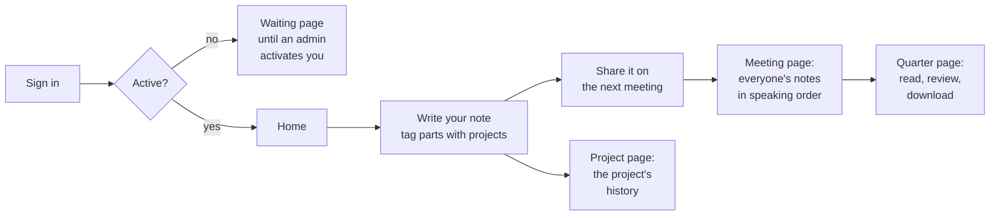
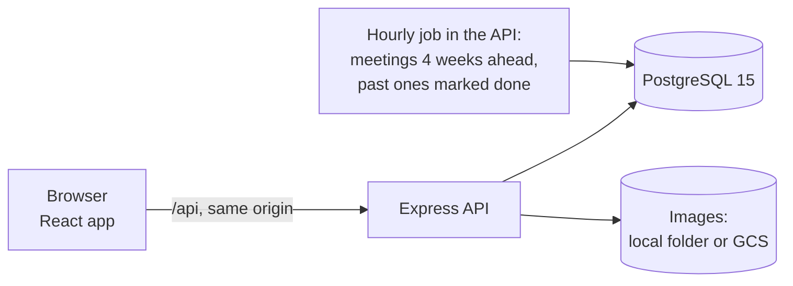

# Weekly Meeting Notes

An internal website for team meetings. Everyone writes their weekly progress in a Word-like editor, marks which parts belong to which project, and shares the note on their team's meeting. In the meeting, the team opens one page and reads everyone's notes in speaking order: nobody collects Word files any more. Over time, each project page becomes the history of that project, and each quarter can be read, or downloaded as PDF or Word, in one go.

> **Status: in development, not released.** Sign-in is a development stand-in (email and name, no password) until the company's Apps Gateway is connected. Do not put the website where other people can reach it, and do not enter real personal data. What still has to happen before go-live is in [`PROJECT.md`](PROJECT.md).

## Contents

- [How people use it](#how-people-use-it)
- [How it is built](#how-it-is-built)
- [Getting started](#getting-started)
- [Environment variables](#environment-variables)
- [What is never committed](#what-is-never-committed)
- [Everyday commands](#everyday-commands)
- [Changing the database](#changing-the-database)
- [Tests](#tests)
- [Troubleshooting](#troubleshooting)
- [Where to read more](#where-to-read-more)
- [Rules for contributors](#rules-for-contributors)

## How people use it

### Who is who

| Who | What they do |
| --- | --- |
| **New person** | Signs in and waits: a first sign-in creates the account as *inactive*, so they see only the "Waiting for activation" page until a website admin activates them. |
| **User** (every active person) | Writes their own notes and keeps their own projects, shares notes on their teams' meetings, and reads what teammates shared there. Anyone can create a team and lead it. |
| **Team leader** (one per team; the others are its members) | Everything a member does, plus: adds and removes people, sets the meeting schedules and how the team's year is split, moves or cancels a meeting, arranges the speaking order, hands the team to someone else, and deletes the team (restorable for 30 days). |
| **Website admin** | Also a User. **Change role** → **Admin** in the account menu shows only Home (with the people waiting for access) and **Users**, where they activate or deactivate people and make others admin. Being admin gives no access to anyone's notes, projects or teams. |

Everyone starts in the User view after signing in.

What stays private: a note is seen only by its writer until they share it on a meeting; then that team's members can read it there, and taking it off the meeting takes their access away again. Projects are private too: a team sees a project only through the parts that were shared on its meetings.

### A week with the website



1. **Sign in.** The first time, you see "Waiting for activation"; the page checks every 30 seconds and opens the website once an admin has activated you. (An admin switches to **Change role** → **Admin**: their Home lists the people waiting for access, and **Users** activates them.)
2. **Home** shows this quarter of each of your teams (how far into it you are), then your next meetings across all your teams.
3. **Teams.** You are in a team once its leader adds you (there is no request to join), or you create one and lead it. The leader sets a meeting schedule once, for example "Weekly Update" every Thursday, and the meetings appear four weeks ahead by themselves. The team page shows its next three meetings, its quarters, its schedules and its members; a star puts a team first in your lists.
4. **Projects.** Create your projects on **Projects**, or straight from the editor while writing. They are yours alone.
5. **Write a note.** **Notes** → **New note** opens a page like a Word document that saves itself as you type. Select lines and press **Project** to put them in a section for one of your projects; one note can cover several projects, a sentence each if you like. Paste, drop or pick pictures (large ones are made smaller first; animated GIFs keep moving). The editor reminds you: work progress only, no personal or confidential data.
6. **Share it on a meeting.** Under the note's title, **Share on** suggests the next meeting of your teams (for a note written in the last two weeks): one click. Or open the meeting and press **Add my note**. Once shared, the row reads **Shared on**, and the × on a meeting takes the note off again.
7. **In the meeting**, everyone opens the meeting page (from Home, the team page or the quarter page). It shows a board: one group per person who added a note, in the speaking order, each note as a card. Open a card to read the note in full and step through all of them with Previous / Next or the arrow keys. The leader drags the groups to set the order, which carries over to the next meetings; each person can also move their own group, and order their own notes. People who have not added a note to this meeting are listed behind **No note yet**.
8. **Look back over a quarter.** Each team's year is split into quarters (the leader can choose 1, 2, 3, 4, 6 or 12 parts a year instead, and the month the year starts). A quarter's page has three tabs:
   - **Meetings**: the next meeting first, then every meeting by month;
   - **Read notes**: the notes of the latest three meetings, meeting by meeting, with **Show all** for the rest; pick meetings or people, and **Save as PDF** or **Save as Word**;
   - **Projects**: a board of what each person shared per project during the quarter.
9. **Follow a project.** Each of your projects has its own page listing every update you wrote for it, newest or oldest first; **Write an update** starts a note with that project's section already in it.
10. **Tidy up.** On **Notes**, tick notes to share, copy (start this week from last week's note), download or delete several at once. Archive a finished project on its page: its parts become read-only, and you can restore it any time.

The website is in English or Bahasa Indonesia: the **ID | EN** switch is in the header, and on the sign-in and waiting pages. Downloads are always in English.

## How it is built

| Part | Technology |
| --- | --- |
| Frontend | React 19, TypeScript, Vite 6, React Router 7, TanStack Query 5, Tiptap (the editor), i18next, BLUE3 design system components and tokens |
| Backend | Node.js 22.18+ running TypeScript directly, Express 4, Zod (input checks), Pino (logs) |
| Database | PostgreSQL 15; Prisma Migrate for the schema only, plain `pg` with parameterized SQL for queries |
| Images | A local folder in development; a private Google Cloud Storage bucket in staging and production |
| Tests | Jest (backend), Vitest (frontend) |



In development the browser talks only to Vite (http://127.0.0.1:5173), which passes `/api` to the backend (http://127.0.0.1:3000). Notes are stored as the editor's JSON, never as HTML, and every image is read through the backend's access check.

```
backend/     Express API: src/modules/<feature>/ (routes, controller, service, repository, types),
             src/database/ (Prisma schema and migrations, local setup, development seed), test/
frontend/    React app: src/pages/ (thin route pages), src/features/<feature>/ (logic and UI),
             src/services/api.ts (the only place that calls the backend), src/components/blue/ (BLUE3)
shared/      TypeScript types used by both apps (types only)
Database Design/   the ERD (picture and its generator)
```

## Getting started

### 1. What you need

- **Node.js 22.18 or newer** and npm. Check with `node -v`: the backend runs its TypeScript directly, which older versions cannot do (see [Troubleshooting](#troubleshooting)).
- **PostgreSQL 15** on `localhost:5432`, with `psql` and a way to run it as the database superuser.
- Git, and the code: clone this repository (its approved home is the company's `gdncomm-ops` GitHub organisation). On Windows, Git Bash or PowerShell both work.

### 2. Install

From the repository root (npm workspaces install the backend, frontend and shared packages at once):

```bash
npm install
```

### 3. Create the local database

Pick a password for the app's own database user (letters and digits keep it simple in the command, the URL and `.env`), then run this once from the `backend` folder as the PostgreSQL superuser. It creates the user `weekly_meeting` and two databases (`weekly_meeting`, and `weekly_meeting_shadow` that Prisma needs to plan migrations). It is safe to run again, but a second run keeps the first password (see [Troubleshooting](#troubleshooting) to change it).

```bash
cd backend
psql -h localhost -U postgres -v app_password=<your-password> -f src/database/setup-local.sql
cd ..
```

How to reach the superuser differs by system:

- **Windows** (the EDB installer): `psql` is usually not on the PATH, so run it by its full path and type the `postgres` password you chose at install. In PowerShell: `& "C:\Program Files\PostgreSQL\15\bin\psql.exe" -h localhost -U postgres -v app_password=<your-password> -f src/database/setup-local.sql`.
- **Linux** (distribution packages): the `postgres` user signs in without a password from its own account, and your shell hands it the file (it may not be allowed into your home folder): `sudo -u postgres psql -v app_password=<your-password> < src/database/setup-local.sql`.
- **macOS** (Homebrew `postgresql@15`): start it with `brew services start postgresql@15`; `psql` is at `$(brew --prefix postgresql@15)/bin/psql`, and the superuser is your own macOS user: `$(brew --prefix postgresql@15)/bin/psql -d postgres -v app_password=<your-password> -f src/database/setup-local.sql`.

### 4. Environment files

Copy the examples and fill them in. The copies are gitignored; never commit them.

```bash
cp backend/.env.example backend/.env
cp frontend/.env.example frontend/.env.local   # optional
```

PowerShell: `Copy-Item backend/.env.example backend/.env` (and the same for the frontend).

In `backend/.env`, put your password into `DATABASE_URL` and `SHADOW_DATABASE_URL` (if it has characters such as `@`, `:` or `/`, write them URL-encoded, for example `%40`), and for local work set:

```
ADMIN_EMAILS=admin.test@example.com
```

so the fictitious admin account below is always an active admin. `frontend/.env.local` is optional; see [Environment variables](#environment-variables).

### 5. Create the tables

```bash
npm run db:migrate --prefix backend
```

### 6. Add sample data

```bash
npm run db:seed --prefix backend
```

This fills the database with a fictitious three weeks of use around today: five teams, four of them with meeting schedules and meetings (past, upcoming, cancelled, moved), projects, and a note from every member for every meeting, pictures included. It **replaces every `@example.com` account and everything they own** each time it runs; other accounts are left alone. It refuses to run with `NODE_ENV=production`.

| Account (sign in with this email and name) | What you can try |
| --- | --- |
| `admin.test@example.com` · Admin Test | Website admin: the Users page, activating New Joiner |
| `pir.leader@example.com` · PIR Leader | Leads Squad A (Wednesday and Friday "Weekly sync") and a deleted team you can restore |
| `pir.1@example.com` … `pir.10@example.com` · PIR 1 … PIR 10 | Members; PIR 3, PIR 6 and PIR 10 lead their own teams |
| `new.joiner@example.com` · New Joiner | A new person waiting for activation |
| `former.member@example.com` · Former Member | A deactivated person |

On the owner's machine a gitignored `dummy_data/` folder may hold the team's real weekly updates; when it is there, the seed loads those instead, and also replaces the accounts of the people in that file (add `-- --synthetic` after the command to get the fictitious data anyway). Without it, you always get the fictitious data.

### 7. Run

Two terminals, from the repository root:

```bash
npm run dev --prefix backend    # API on http://127.0.0.1:3000, restarts when you change its code
npm run dev --prefix frontend   # website on http://127.0.0.1:5173
```

In VS Code, **Ctrl+Shift+B** starts both (`.vscode/tasks.json`).

Open http://127.0.0.1:5173 and press **Quick sign-in with a test account**, or type any email and name into the form. A new email creates a new inactive account, as a first sign-in through the company gateway will.

### 8. Check it works

- http://127.0.0.1:3000/api/health answers `{"status":"ok","database":"up"}`. A `503` with `"database":"down"` means the API runs but cannot reach PostgreSQL: check `DATABASE_URL`.
- `npm test --prefix backend` and `npm test --prefix frontend` pass (see [Tests](#tests)).

## Environment variables

### Backend: `backend/.env`

Read and checked once at start-up (`backend/src/config/env.ts`); a wrong value stops the backend with a message that names the variable but never shows its value.

| Variable | Needed | Default | What it does |
| --- | --- | --- | --- |
| `DATABASE_URL` | **yes** | | PostgreSQL connection, `postgresql://weekly_meeting:<password>@localhost:5432/weekly_meeting?schema=public` |
| `SHADOW_DATABASE_URL` | for `db:migrate` | | Prisma's scratch database for planning migrations (development only) |
| `ADMIN_EMAILS` | no | empty | Comma-separated emails made active admins on every sign-in: the first admin, and a way back in. They cannot be changed from the Users page |
| `NODE_ENV` | no | `development` | `production` turns the mock sign-in off and makes cookies Secure. Every deployment must set it |
| `HOST` | no | `127.0.0.1` | Where the API listens; a container sets `0.0.0.0` |
| `PORT` | no | `3000` | The API's port (the frontend's proxy expects 3000) |
| `SESSION_TTL_HOURS` | no | `8` | How long a sign-in lasts (1 to 24) |
| `DB_POOL_MAX` | no | `10` | Database connections per backend process |
| `LOG_LEVEL` | no | `info` | `fatal`, `error`, `warn`, `info`, `debug`, `trace` or `silent` |
| `STORAGE_DRIVER` | no | `local` | Where images go: `local` (a folder) or `gcs` (a Google Cloud Storage bucket) |
| `LOCAL_STORAGE_DIR` | no | `uploads` | The folder for `local`, relative to `backend/`. Only the default `backend/uploads/` is gitignored |
| `GCS_BUCKET` | with `gcs` | | The bucket's name. Credentials come from the platform (Application Default Credentials), never from a file |

### Frontend: `frontend/.env.local` (optional, development only)

| Variable | What it does |
| --- | --- |
| `VITE_TEST_ACCOUNTS` | Replaces the quick sign-in list, as `email\|Name;email\|Name`. For a seed of real people: their names and work emails stay in this gitignored file, never in the code |
| `VITE_EXTRA_TEST_ACCOUNTS` | Accounts added at the top of the list, such as your own |

A production build leaves the quick sign-in list out whatever these say.

### Staging and production

There are no `.env` files on the platform. The company platform (AIVA) keeps the values in Vault, seeded from `backend/.env.example`, so keep that file complete, with placeholders only (the optional variables are listed in its comment with their defaults). A deployment must set `NODE_ENV=production`, `HOST=0.0.0.0`, `STORAGE_DRIVER=gcs` and `GCS_BUCKET` explicitly. The deployment itself is not set up yet.

## What is never committed

`.gitignore` keeps these out of git, and they must stay out:

| Path | Why |
| --- | --- |
| `backend/.env`, `frontend/.env.local` (any `.env.*` except `.env.example`) | Passwords, connection strings, and possibly real names and emails |
| `backend/uploads/` | Images saved by the local storage driver |
| `dummy_data/` | The team's real weekly updates used for local testing (real names, work emails, internal work) |
| `node_modules/`, `dist/`, `coverage/`, `*.log` | Installed and generated files |

Only the two `.env.example` files are committed, and they hold placeholders only. Code, tests and fixtures use fictitious people only (`@example.com`, `@example.test`): never a real name, work email or real note text. Before every commit, look at `git status` and the staged diff for secrets or personal data.

## Everyday commands

Run from the repository root.

| Task | Command |
| --- | --- |
| Start the API / the website | `npm run dev --prefix backend` / `npm run dev --prefix frontend` |
| Run the tests | `npm test --prefix backend` / `npm test --prefix frontend` |
| Type check | `npm run typecheck --prefix backend` / `npm run typecheck --prefix frontend` |
| Build | `npm run build --prefix backend` (to `backend/dist`) / `npm run build --prefix frontend` (to `frontend/dist`) |
| Apply migrations (development) | `npm run db:migrate --prefix backend` |
| Write a migration without applying it | `npm run db:migrate:new --prefix backend -- --name <what_changed>` |
| Apply migrations (staging, production) | `npm run db:deploy --prefix backend` |
| See which migrations are applied | `npm run db:status --prefix backend` |
| Fill with sample data | `npm run db:seed --prefix backend` |

## Changing the database

1. Edit `backend/src/database/prisma/schema.prisma`.
2. Write the migration without applying it: `npm run db:migrate:new --prefix backend -- --name <what_changed>`. Prisma adds a folder under `backend/src/database/prisma/migrations/`.
3. Read its `migration.sql` before it runs. Prisma cannot express everything this database uses (CHECK constraints, partial and expression indexes): add those by hand at the end of the file (earlier migrations show how), and make sure nothing generated drops one of them.
4. Apply it: `npm run db:migrate --prefix backend`. (This command alone also works for a plain change, but it applies the migration at once, and editing a migration after it ran makes Prisma ask to reset the database.)
5. Commit the migration folder with the code that needs it. Migrations only move forward, and a release must still work with the previous schema.

Prisma is used for migrations only: the app queries the database with plain SQL through `pg`, always with `$1` placeholders.

## Tests

- **Backend** (Jest): unit tests, plus database tests that run when `backend/.env` has a `DATABASE_URL`. They use the same database as the app and run one file at a time because they share it. They delete **every** `@example.test` account before and after they run, so never use that domain for accounts of your own; the sample data uses `@example.com`. To run one file: `npm test --prefix backend -- test/notes.test.ts`.
- **Frontend** (Vitest): logic, the word lists in both languages, and the PDF and Word files built and read back.
- Changing behaviour means adding or updating tests: an API change needs its success, validation, authorization and edge cases tested.

## Troubleshooting

| What you see | Why, and what to do |
| --- | --- |
| Signed out all of a sudden | Sign-ins are kept in the backend's memory, so every backend restart signs everyone out (`npm run dev` restarts it when its code changes), and running the seed again makes the test accounts anew. Sign in again |
| The page loads but nothing comes, errors on `/api` | The backend is not running, or not on port 3000 |
| `Invalid environment: …` when the backend starts | A variable in `backend/.env` is missing or wrong; the message names it |
| `bad option: --env-file-if-exists`, or `Unknown file extension ".ts"` | Node.js is older than 22.18: update it (`node -v`) |
| `password authentication failed for user "weekly_meeting"` | The password in `DATABASE_URL` is not the one the user was created with. Set it again as the superuser: `psql -h localhost -U postgres -c "ALTER ROLE weekly_meeting PASSWORD '<your-password>'"` (on Linux `sudo -u postgres psql -c "…"`) |
| `db:migrate` complains about the shadow database | Run `setup-local.sql` (it creates both databases) and check `SHADOW_DATABASE_URL` |
| Port 5173 is already in use | Another dev server is running; the frontend does not move to another port, so stop the other one |
| A test account sees "Waiting for activation" | On purpose: New Joiner waits for activation and Former Member was deactivated. Sign in as Admin Test, switch to Admin and activate them, or use another account |

## Where to read more

| File | What is in it |
| --- | --- |
| [`CONTEXT.md`](CONTEXT.md) | The project's current state: every folder and module, key decisions, what is done and open. Start here before changing code |
| [`PRD & RFC Weekly Meeting Notes.md`](PRD%20%26%20RFC%20Weekly%20Meeting%20Notes.md) | Requirements, user flows, access rules, data model and API outline |
| [`PROJECT.md`](PROJECT.md) | The go-live dossier: risk level, data used, sign-in method, access levels, release steps |
| [`AGENTS.md`](AGENTS.md) / [`CLAUDE.md`](CLAUDE.md) | Rules for AI coding agents (identical copies), with the build and run commands |
| [`Database Design/`](Database%20Design/) | The ERD of the database |

## Rules for contributors

- Follow the company standards the project already uses: the stack above, the folder layout (`backend/`, `frontend/`, `shared/` at the root, one folder per feature), BLUE3 components and tokens for the UI, and the security rules in `AGENTS.md`. A different library or stack choice needs approval first (`PROJECT.md` → Stack Exceptions).
- Check every new dependency for known vulnerabilities and an allowed license before adding it, and pin its exact version.
- No secrets, real personal data or real notes in code, tests, logs or commits.
- The approved place for the code is the company GitHub organisation (`gdncomm-ops`); use branches and pull requests.
- Releases go through the company platform (AIVA) and, for this project's proposed Medium risk, an independent review before anyone else uses the website (see `PROJECT.md`).
